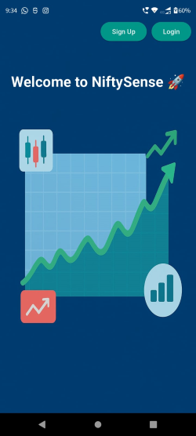
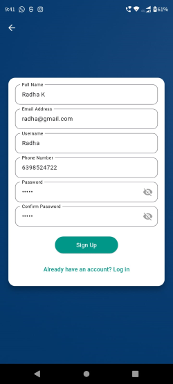
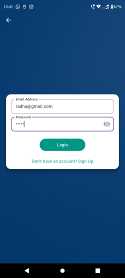
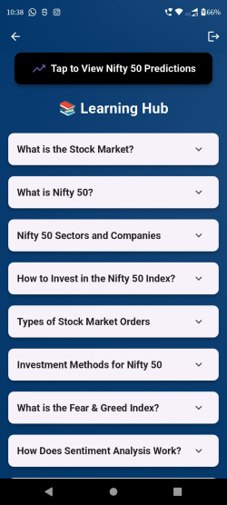
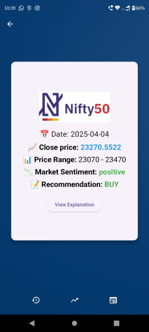
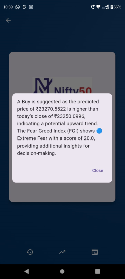
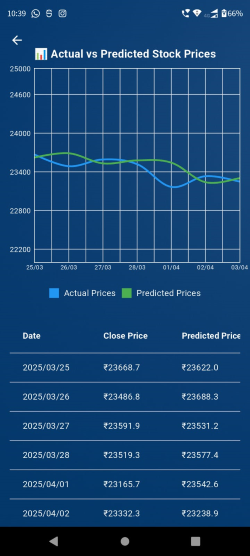
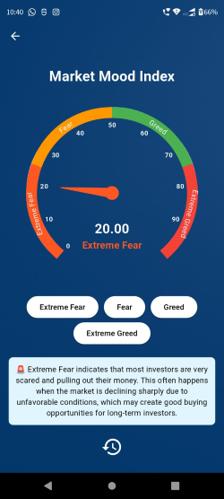
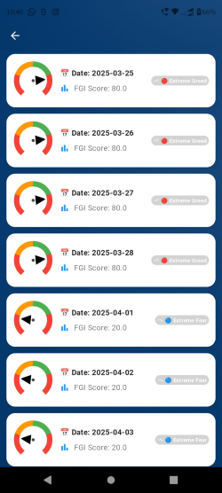
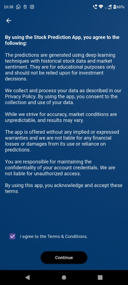

# 📌 Nifty50 Stock Market Prediction using Deep Learning

A deep learning–based project that predicts the next day's NIFTY 50 closing price using RNN, LSTM, Transformer (Encoder-only), and a hybrid LSTM+Transformer model. The best-performing model (LSTM) is served through a Flask backend and consumed by a Flutter mobile app that also shows market sentiment, a Fear & Greed Index (FGI), and Buy/Sell/Hold recommendations.

---

## 👥 Team Members

- **Padala Kalyani** — padalakalyani66@gmail.com
- **Addada Sai Keerthana** — 2mailsaikeerthana@gmail.com

---

## 📂 Repository Structure

```
nifty50-stock-prediction-deeplearning/
├── data/                      # Training data used for the research/model-development notebooks
├── data_generation/           # Scripts that built the training datasets
├── deeplearning_models/       # RNN / LSTM / Transformer / hybrid notebooks (model research)
├── timeseries_analysis/       # EDA, ACF/PACF, ARIMA, SARIMA notebooks
├── prediction_code/           # Standalone prediction notebook
├── models/                    # Saved best model (LSTM_model_best.h5) from research
├── docs/                      # Dissertation write-up (PDF)
├── mobile_application/
│   ├── backend/                # Flask API: prediction, sentiment, FGI, recommendations, auth
│   │   ├── app.py               # Main Flask app / API routes
│   │   ├── model.py             # Loads models/LSTM_model_best.h5 and predicts next close
│   │   ├── stocks_data.py       # Pulls latest NIFTY 50 data from Yahoo Finance
│   │   ├── news_data.py         # Pulls NIFTY 50 news via NewsAPI
│   │   ├── sentiment_analysis.py# FinBERT sentiment scoring on news
│   │   ├── fgi_data.py / fgi_model.py  # Fear & Greed Index pipeline
│   │   ├── interest_rate.py / gdp.py / inflation_rate.py  # Macro data collectors
│   │   ├── stock_recommendations.py    # Buy/Sell/Hold logic
│   │   ├── models/               # Copy of the trained model used at inference time
│   │   ├── data/                 # CSVs the backend reads/writes at runtime
│   │   ├── requirements.txt
│   │   └── .env.example          # Template for required secrets/config (copy to .env)
│   ├── frontend/                # Flutter mobile app
│   │   ├── lib/services/api_service.dart, auth_service.dart  # read backend URL from .env
│   │   └── .env.example          # Template for backend URL config (copy to .env)
│   └── app_images/              # Screenshots used below
├── requirements.txt            # Dependencies for the research notebooks (data/, deeplearning_models/, etc.)
└── LICENSE
```

There are two independent Python environments in this repo — the **research notebooks** at the repo root (`requirements.txt`), and the **backend API** (`mobile_application/backend/requirements.txt`). Install them separately; you don't need the research notebooks to run the app.

---

## 🔍 Project Overview

- Deep learning–based next-day closing price prediction.
- Real-time financial news sentiment analysis via FinBERT.
- Daily Fear & Greed Index (FGI) from technical + macroeconomic indicators.
- A Flutter mobile app for predictions, trends, and financial news.
- A learning hub explaining key stock market terms.

Several architectures were tested; only the best-performing one ships in the app.

## ⏳ Time Series Analysis (`timeseries_analysis/`)

- Trend/seasonality decomposition, ACF/PACF lag analysis, ADF stationarity test, rolling windows, ARIMA/SARIMA baselines.

## 🧠 Deep Learning Architectures Explored (`deeplearning_models/`)

RNN · LSTM (unidirectional, stacked, bidirectional) · Transformer (encoder-only) · Hybrid LSTM+Transformer.

Best result: **LSTM, 60-day sequence length, Close price input** — MAE 116.82, RMSE 167.69. This is the model used in the app.

## ⚙️ How the Backend Works

1. **Data collection** — last 60 days of NIFTY 50 data from Yahoo Finance + latest news articles.
2. **Prediction** — the saved LSTM model predicts next-day close (with a realistic range).
3. **Sentiment** — FinBERT classifies news as Positive/Negative/Neutral.
4. **FGI** — combines SMA/EMA/RSI/MACD with GDP, inflation, and interest rate into a 0–100 score and label.
5. **Recommendation** — Buy/Sell/Hold from close price, prediction, sentiment, and FGI, with a short explanation.
6. **Storage** — daily predictions and sentiment are appended to CSVs in `mobile_application/backend/data/` for history.

---

## 🚀 Setup — Backend (Flask API)

All backend paths are resolved relative to the script's own folder (`os.path.dirname(__file__)`), so run these commands **from inside `mobile_application/backend/`** — not the repo root.

```bash
git clone https://github.com/SaiKeerthana-2000/nifty50-stock-prediction-deeplearning.git
cd nifty50-stock-prediction-deeplearning/mobile_application/backend

python -m venv venv
source venv/bin/activate        # Windows: venv\Scripts\activate

pip install -r requirements.txt

cp .env.example .env            # then fill in your real values (see below)

python app.py
```

The API starts on `http://<your-machine-ip>:5000` by default (Flask dev server — check the console output for the exact host/port).

### Required configuration (`.env`)

Copy `mobile_application/backend/.env.example` to `.env` in the same folder and fill in:

| Variable | Used by | Notes |
|---|---|---|
| `DB_HOST`, `DB_USER`, `DB_PASSWORD`, `DB_NAME` | `app.py` | MySQL database for signup/login |
| `NEWS_API_KEY`, `NEWS_API_URL` | `news_data.py` | Get a free key at newsapi.org |
| `INTEREST_RATE_API_URL` | `interest_rate.py` | Real interest rate data source (e.g. World Bank API) |

### Database setup (required before signup/login will work)

Filling in `DB_HOST`/`DB_USER`/`DB_PASSWORD`/`DB_NAME` in `.env` is not enough by itself — nothing in this project creates the database or table for you. You must have MySQL installed and running, then create the database and table yourself:

```sql
CREATE DATABASE your_database;
USE your_database;

CREATE TABLE users (
    id INT AUTO_INCREMENT PRIMARY KEY,
    name VARCHAR(255),
    email VARCHAR(255) UNIQUE,
    username VARCHAR(255) UNIQUE,
    password VARCHAR(255),
    phone VARCHAR(20)
);
```

Use whichever client you prefer to run this (MySQL Workbench, `mysql` CLI, DBeaver, etc.) — just make sure `your_database` matches `DB_NAME` in your `.env` exactly. Without this table, `/register` and `/login` will return `500` errors even with a correct `.env`.

### First run / data bootstrap

The backend reads CSVs from `mobile_application/backend/data/` (stock prices, predictions, sentiment, FGI, macro data). A starter set is included. Trigger the collector scripts (`stocks_data.py`, `news_data.py`, `fgi_data.py`, etc.) once, or call the corresponding API routes, to refresh them with current data before relying on predictions.

---

## 📱 Setup — Mobile App (Flutter)

### Prerequisites
- Flutter SDK
- Android Studio or VS Code with the Flutter/Dart plugins
- The backend above running and reachable from your device/emulator

### Steps

```bash
cd mobile_application/frontend
flutter pub get
```

Set the backend URL the app will call. This lives in a `.env` file (not hardcoded in the Dart source), and **cannot be a relative path** since the app and the API run as two separate processes, possibly on two separate machines:

```bash
cp .env.example .env
```

Then edit `.env` and set:


API_BASE_URL=http://192.168.1.100:5000


Use your machine's LAN IP, not `localhost`, if you're running the app on a physical device or emulator. `.env` is git-ignored — never commit your real one.

Then run:

```bash
flutter run
```
launches a debug build on a connected device or emulator — good for testing, but not something you can install standalone or share with someone else.

### Building an installable app (APK / IPA)

To create an actual installable app file instead of running in dev mode:

**Android (APK):**
```bash
flutter build apk --release
```
Output: `build/app/outputs/flutter-apk/app-release.apk` — copy this to a phone and install it directly (enable "install from unknown sources" if prompted), or upload it to the Play Store.

**Android (App Bundle, for Play Store upload):**
```bash
flutter build appbundle --release
```
Output: `build/app/outputs/bundle/release/app-release.aab`

**iOS (IPA, requires a Mac + Apple Developer account):**
```bash
flutter build ipa --release
```
Output goes to `build/ios/ipa/` — this needs code signing set up in Xcode (open `ios/Runner.xcworkspace`, set your Team under Signing & Capabilities) before it will build successfully.

Before building for release, double check `API_BASE_URL` in your `.env` points at your **production** backend URL, not a local dev IP — the release build won't be on the same network as your dev machine.

---

## 🛠️ Technologies Used

- **Deep Learning:** TensorFlow, Keras, PyTorch (FinBERT)
- **Time Series:** ARIMA, SARIMA, ACF/PACF, decomposition
- **APIs:** Yahoo Finance (`yfinance`), NewsAPI
- **Frontend:** Flutter
- **Backend:** Flask (Python)
- **Sentiment:** FinBERT
- **Visualization:** Matplotlib, Seaborn

---

## 📱 Mobile Application Features

- **Daily Prediction** — date, predicted close (with range), sentiment, recommendation, explanation.
- **Fear & Greed Index** — daily score/label + historical chart.
- **Past Predictions** — actual vs predicted history.
- **News & Sentiment** — latest NIFTY 50 news with FinBERT sentiment tags.
- **Learning Hub** — stock market basics, NIFTY 50, technical indicators.

## 🖼️ Screenshots

| | | |
|---|---|---|
|  |  |  |
|  |  |  |
|  |  |  |
|  |  | |

---

## 📫 Contact

- padalakalyani66@gmail.com
- 2mailsaikeerthana@gmail.com

## 📄 License

MIT — see [LICENSE](LICENSE).
